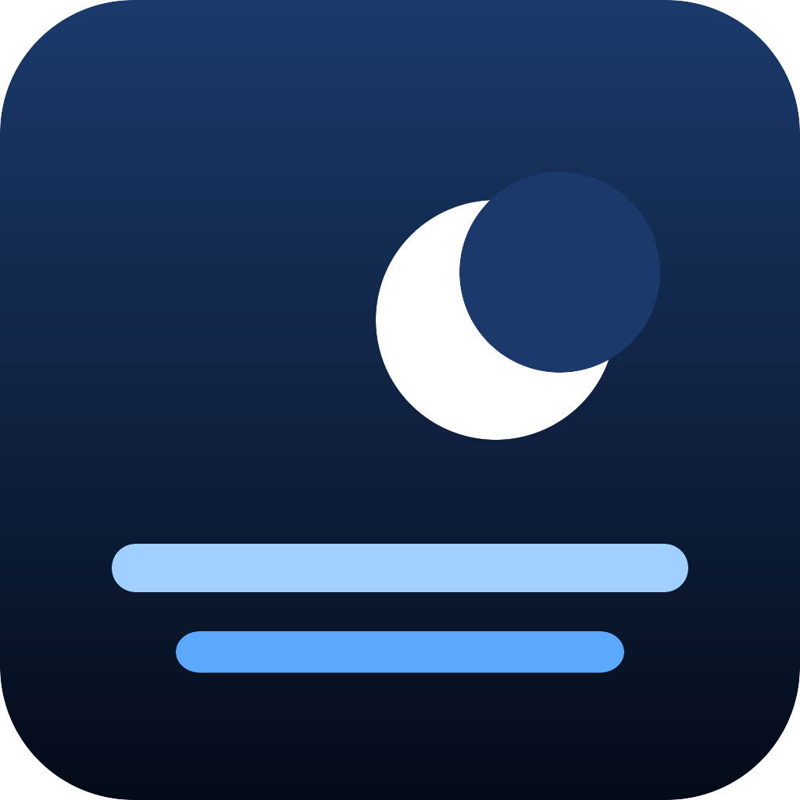

<p align="center"></p>
<h1 align="center">webOS Aerials</h1>
<p align="center">把 Apple TV 的 4K 航拍屏保搬到 LG webOS 电视上。不需要 root。</p>

---

Apple 为 tvOS 公开了一份航拍清单（`sylvan.apple.com/Aerials/resources-*.tar`），114 段 4K HEVC 的风景、城市、太空和水下镜头，
每段都带中文地名描述。这个项目用一个普通的 webOS 网页应用把它们播出来：

- **独立 App**：打开就播，随机顺序，段与段之间淡入淡出，开头几秒显示地名和时钟，然后淡出（照顾 OLED）。OK 打开设置，返回键退出。
- **启动器模块**：同一套代码可以嵌进自制启动器（比如 [Clean Your TV](https://github.com/Razdva122/clean-your-tv-lg-webos)），启动器前台空闲几分钟后自动开始，任意键退出且那一下按键不会传给启动器。见 [docs/clean-your-tv.md](docs/clean-your-tv.md)。
- **本地缓存**：可选。配套的 JS 服务把若干段下载到电视本地（断点续传、换设置自动清理、空间不足自动停），之后这些段从本地文件播放；也可以只播本地缓存。

视频默认直接从 Apple 的 CDN 流式播放，和 Apple TV 自己的做法一样。LG C5（webOS 25）实测 4K HDR、4K SDR、1080p HEVC、1080p H.264 四种都能直接播，3 秒内出画面。

## 安装

前置：LG **开发者模式**（[LG 文档](https://webostv.developer.lge.com/develop/getting-started/developer-mode-app)）、
Node.js 20+ 和 webOS CLI（`npm i -g @webos-tools/cli`），并用 `ares-setup-device` 配好电视。

```sh
git clone https://github.com/lfkdsk/webos-aerials.git
cd webos-aerials
DEVICE=<ares 设备名> scripts/deploy.sh
```

或者只打包：`scripts/build.sh`，产物在 `dist/com.lfkdsk.aerials_1.0.0_all.ipk`，用 `ares-install` 或 [Dev Manager Desktop](https://github.com/webosbrew/dev-manager-desktop) 安装。
开发者模式有计时，到期会删掉侧载应用，记得续期。

## 使用

| 按键 | 作用 |
|---|---|
| OK | 打开设置面板 |
| 返回 | 退出应用（设置面板打开时：关闭面板） |
| 其他键 / 移动遥控器 | 暂停播放并显示提示，几秒后自动继续 |

设置面板（方向键上下换行，左右改值）：

| 项 | 选项 |
|---|---|
| 画质 | 4K HDR / 4K / 1080p；每段按这个顺序尝试，不支持的自动降级 |
| 风景 · 城市 · 太空 · 水下 | 四个类别开关，至少保留一个 |
| 本地缓存 | 关 / 5 / 10 / 20 段，显示预计体积（4K 约 0.35 GB/段，HDR 约 0.7 GB/段，1080p 约 0.17 GB/段） |
| 只播本地缓存 | 开后只用已下载的段；一段都没有时仍走网络 |
| 立即预览 / 清空缓存 | — |

面板底部显示已缓存数量、当前下载进度和电视剩余空间。下载只在应用显示在屏幕上时进行。

## 工作方式

```text
app/
  aerials.js            由 scripts/make-aerials.py 从 Apple 清单生成：id、英文地名、中文描述、类别、各画质 URL
  screensaver.js        播放逻辑：空闲计时、随机队列、淡入淡出、HUD、画质回退、与缓存服务的订阅
  screensaver-panel.js  设置面板
  standalone.js         独立 App 的外壳：开即播、按键含义、退出
service/
  cache.js              下载与缓存：Range 续传、.part 文件、目标集合同步与清理、空间检查（纯 node，可单测）
  service.js            webOS 服务封装：sync（可订阅进度）/ status / clear；下载期间用 ActivityManager 保活
scripts/make-aerials.py 重新生成 aerials.js
tests/cache.test.mjs    缓存逻辑单测（node --test）
```

要点：

- 网页应用跑在 `file://` 下，拿不到 Apple 清单（没有 CORS 头），所以清单在构建时烤进 `aerials.js`；视频本身是 `<video src>`，不受 CORS 限制。
- 同一时刻只有一个 `<video>`，段与段之间经黑场切换：电视只有一个 4K 硬解通道，两个 4K 元素交叉淡化会失败。
- 每段有 25 秒的启动看门狗：CDN 抽风或某个画质不被支持时自动换下一档或下一段，不会黑屏卡住。
- 遥控器指针偶尔会无故上报一次移动，所以指针要移动超过 24px 才算退出。
- 缓存目录在服务自己的包目录里（`…/services/<id>/cache`），重新安装应用会清空；服务会按设置重新下载。
- 页面只保留一个到服务的订阅（`sync` + `subscribe:true`），服务把下载进度推回来；页面不可见时断开订阅，正在进行的下载靠 ActivityManager 继续到结束。

更新清单：

```sh
curl -o resources.tar https://sylvan.apple.com/Aerials/resources-16.tar
mkdir x && tar -xf resources.tar -C x
python3 -I scripts/make-aerials.py x/entries.json x/TVIdleScreenStrings.bundle/zh_CN.lproj/Localizable.nocache.strings
```

## 开发

```sh
npm test                 # 缓存逻辑单测（本地 http 服务器模拟 CDN）
python3 -m http.server --directory app 8765   # 在桌面 Chrome 里看界面（Chrome 不解 HEVC，会回退到 H.264）
DEVICE=<设备名> scripts/deploy.sh inspect     # 真机远程 DevTools
```

## 说明

- 视频版权归 Apple 所有，本项目只是从 Apple 公开的清单地址播放，不分发视频文件；本地缓存只存在你自己的电视上。
- 非官方项目，与 Apple、LG 无关。仅供个人学习使用。
- 没有 root 就无法替换 LG 系统自带的屏保，所以独立 App 需要手动打开；要「空闲自动触发」，请把模块嵌入你的启动器（见 docs）。
